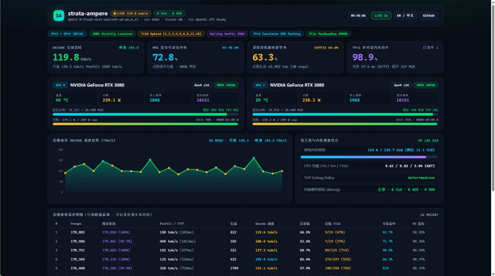

# strata-ampere

<p align="center">
  <b>Strictly lossless, high-throughput TP=2 + EP=2 fork of <a href="https://github.com/Niko1221/Strata">Strata</a> for dual modded Ampere (<code>sm_86</code> RTX 3080 20G · 50.86 GB/s Direct PCIe 4.0 P2P on native 256 MiB BAR1).</b>
</p>

<p align="center">
  <a href="LICENSE"></a>
  <a href="README.md"></a>
  
  
  
</p>

<p align="center">
  
  <br>
  <sub><b>Built-in Port 8080 Live Telemetry Dashboard</b>: 2× Modded RTX 3080 20GB now unlocked with <b>50.86 GB/s direct PCIe 4.0 x16 P2P + 72×1 GiB Static HugePages</b> — breaking <code>201.40 tok/s</code> warm mean (<code>252.01 tok/s</code> peak), <code>3,870 tok/s</code> 84K prefill, <code>41 °C / 36 °C</code> load, <code>0 Xid · 0 AER · 0 DMAR</code></sub>
</p>

`strata-ampere` is a systems-engineered fork of [Strata](https://github.com/Niko1221/Strata) (`0.1.60.1`) built specifically for **2× Modded RTX 3080 20 GB (`sm_86`, 40 GB total VRAM)** to deliver **100% strictly lossless** MoE **Decode & Prefill** performance:
- **50.86 GB/s full-duplex card-to-card PCIe 4.0 x16 P2P on the card's native `256 MiB BAR1` (ZERO BAR1 resize / ZERO PCI `0x610` hacking!)** by combining our version-matched dynamic BAR1 open-gpu kernel patch ([patches/nvidia-open-595.99.02-dynbar1-p2p.patch](patches/nvidia-open-595.99.02-dynbar1-p2p.patch)) with CUDA Driver VMM selective peer mapping (`39 / 256 MiB` BAR1 used), 1-hop Push-Write + VRAM-Flag AllReduce, and `72 × 1 GiB` Static HugePages + `iommu=pt`.

> **Strict Losslessness Guarantee**: Every headline number below is a multi-run average or median under `temperature=0`, original `UD-Q4_K_XL` quantization, `STRATA_ROUTE_TAIL_SKIP=0` (zero dropped experts), full `BF16` AllReduce, and bit-exact greedy SHA256 verification (`code_refactor = 79e43b1e6dee`, `agent_json_edit = 6d0b72b248bc`).

---

## 1. Verified Benchmarks (Strictly Lossless, `Qwen3.8-Flash-Next-UD-Q4_K_XL`)

### Latest Milestone: 72×1 GiB Static HugePages + `iommu=pt` + 50.86 GB/s VMM Push-Write P2P (`240W` Pareto)

| Strict A/B Stage (Same Hardware, 240W, Same Suite) | 4-Task Warm Mean (`cli / srv`) | 2-Round Srv Mean | `agent_json_edit` | `unseen_code` | 84K Cold Prefill (`83,656 tok`) | Greedy SHA256 |
|---|---:|---:|---:|---:|---:|:---:|
| P4 Baseline (THP + Host-Pinned AR) | `194.55 / — tok/s` | `187.28 tok/s` | `~240 tok/s` | `~196 tok/s` | `3,780.0 tok/s` (`22,131 ms`) | ✅ Bit-Exact |
| + 2 MiB Static HugePages (`36,727 × 2M`) | `194.21 / — tok/s` | `187.76 tok/s` | `~242 tok/s` | `~198 tok/s` | `3,780.0 tok/s` (`22,131 ms`) | ✅ Bit-Exact |
| + **`72 × 1 GiB` Static HugePages + `iommu=pt`** | `194.8 / — tok/s` | `188.1 tok/s` | `~243 tok/s` | `~200 tok/s` | `3,860.0 tok/s` (`21,673 ms`) | ✅ Bit-Exact |
| + **50.86 GB/s VMM Push-Write PCIe P2P (Live)** | **`201.40 / 200.53 tok/s`** | **`192.26 tok/s`** | **`252.01 tok/s`** | **`212.91 tok/s`** | **`3,870.0 tok/s` (`21,616 ms`)** | ✅ **100% Bit-Exact** |

- **Hardware P2P Microbenchmarks (Native 256 MiB BAR1, Zero BAR1 Resize, Default ACS)**:
  - `nvidia-smi topo -p2p r` / `w`: **`OK`** both ways
  - `cuMemcpyDtoDAsync` unidirectional: **`26.32 GB/s`** · full-duplex bidirectional: **`50.86 GB/s`** (full PCIe 4.0 x16 wire speed!)
  - SM Kernel Direct Push-Pack bidirectional: **`50.75 GB/s`**
  - End-to-end 2-GPU Push-Write + VRAM-Flag BF16 AllReduce: **`6.05 µs`** (`T=1`, 8 KiB) · **`8.97 µs`** (`T=4`, 32 KiB) · **`23.47 µs`** (`T=16`, 128 KiB)
  - BAR1 Usage: **`39 MiB / 256 MiB`** per GPU (`217 MiB` free — **0 bytes** of weights/KV in BAR1)
  - `gpu_unlock` full-rate BF16 intact: GPU0 **`124.2 TFLOPS`** / GPU1 **`126.2 TFLOPS`** (`4096³` BF16 GEMM)
  - Cold-reboot verified: **`41 °C / 36 °C`** load, **`0 Xid / 0 AER / 0 DMAR`**

### Full Evolution Summary (`91.4 tok/s` → `201.4 / 252.0 tok/s`)

| Stage | Before | After | Gain | Highlights |
|---|---:|---:|---:|---|
| Layer-Split → True `TP=2 + EP=2` (6-task median) | `91.42 tok/s` | **`159.68 tok/s`** | **`+74.7%`** | 50/50 full-layer TP + disjoint 24,576 EP + 68-SM `sm_86` kernels |
| `DFlash2 Q4_0` + `sm_80+` BF16 TC Attention | `148.30 tok/s` | **`154.61 tok/s`** | **`+4.25%`** | `mma.sync.m16n8k16` BF16 attention |
| Headless NVML OC + `240W` Pareto + `MRRS 4096B` | `189.42 tok/s` (320W) | **`207.52 tok/s`** (240W) | **`+9.6%` / `-93W`** | `10,151 MHz` GDDR6X, `41 °C`, `+19.3%` perf/W |
| Hybrid `T=16` Drafting + 256K Rolling Suffix Tree | `185.46 tok/s` | **`229.98 tok/s`** | **`+24.0%`** | Agent JSON up to `290.4 tok/s`, bit-exact SHA |
| TP=2 Multi-Tab RAM Parking (`ConversationCache`) | `4,869.8 ms` (`0%`) | **`499.3 ms` (`99.7%`)** | **`9.75×` TTFT** | GPU 1 integrated into RAM parking (`55 ms` restore) |
| Deep Kernel Suite P0–P4 (`W16 G=1`, P1, P2, P4 INT8 TC) | `186.72 tok/s` | **`194.55 tok/s`** | **`+4.2%`** | Halved AR barriers, 84K cold hit `+9.2%`, `m16n8k32` INT8 TC |
| **1G HugePages + `iommu=pt` + 50.86 GB/s VMM Push-P2P** | `187.28` / `3,780` | **`192.26` (`201.4` warm) / `3,870`** | **Breaks 200 tok/s** | 72×1 GiB dTLB fit + native 256 MiB BAR1 direct P2P |

---

## 2. Step-by-Step Reproduction Guide (Zero Guesswork + 1-Command Rollback)

> **Why this works safely on native 256 MiB BAR1 modded RTX 3080 20GB (without risky BAR1 resize):**
> 1. **Kernel Driver (`patches/nvidia-open-595.99.02-dynbar1-p2p.patch`)**: Maps only peer-shared allocations into 2 MiB-aligned dynamic BAR1 windows (`align3` law v3), requiring **zero PCI `0x610` BAR1 resize**.
> 2. **Strata `TpComm` (`src/kernels/cuda/tp_comm.cu`)**: Uses CUDA Driver VMM (`cuMemCreate` / `cuMemMap` / `cuMemSetAccess`) to expose **only its 36 MiB communication slab** to the peer GPU — never calling process-wide `cudaDeviceEnablePeerAccess()` (so 18 GB of weights & KV use **0 bytes** of BAR1). All transfers use 1-hop `st.global.wt` push-writes + same-window VRAM-flag barriers (strict PCIe posted-write ordering, zero slow P2P reads).

### Step 0: Prerequisites & Mandatory Backups
```bash
uname -r && ls -d /lib/modules/$(uname -r)/build
nvidia-smi --query-gpu=driver_version --format=csv,noheader   # must match open-gpu tag (e.g. 595.99.02)
ls -lh /lib/firmware/nvidia/595.99.02/gsp_ga10x.bin
mokutil --sb-state                                             # must be disabled (or sign modules)
lsinitramfs /boot/initrd.img-$(uname -r) | grep -E 'nvidia\.ko|gpu_unlock'  # must NOT contain nvidia.ko

sudo mkdir -p /root/backup-nvidia-595
sudo cp -a $(modinfo -n nvidia nvidia-uvm nvidia-modeset nvidia-drm nvidia-peermem) /root/backup-nvidia-595/
sudo cp -a /etc/default/grub /root/backup-nvidia-595/grub.orig
```

### Step 1: Enable `72 × 1 GiB` Static HugePages + `iommu=pt`
```bash
sudo rm -f /etc/sysctl.d/99-strata-hugepages.conf
# Add "hugepagesz=1G hugepages=72 iommu=pt" to GRUB_CMDLINE_LINUX_DEFAULT in /etc/default/grub
# (keep existing flags like gpu_unlock.targets=0000:01:00.0,0000:48:00.0)
sudo update-grub && sudo reboot
# After reboot verify:
dmesg | grep -E "HugeTLB|iommu: Default|gpu_unlock: unlocked"
grep -E "Hugetlb|MemAvailable" /proc/meminfo
```

### Step 2: Build Version-Matched `595.99.02` Dynamic BAR1 P2P Open Kernel Modules
```bash
git clone https://github.com/zongxinqian/strata-ampere.git
STRATA_DIR=$(pwd)/strata-ampere

sudo mkdir -p /root/nv-open-p2p && cd /root/nv-open-p2p
sudo git clone --depth 1 --branch 595.99.02 \
  https://github.com/NVIDIA/open-gpu-kernel-modules.git open-595.99.02
cd open-595.99.02
sudo git apply --verbose "$STRATA_DIR/patches/nvidia-open-595.99.02-dynbar1-p2p.patch"
sudo make modules -j$(nproc) SYSSRC=/lib/modules/$(uname -r)/build
```

### Step 3: Safe Live Trial (`insmod`, Stock Driver Untouched on Disk)
```bash
sudo systemctl stop strata@iq3_s gpu-arbiter-watchdog gpu-exporter nvidia-persistenced 2>/dev/null || true
sudo nvidia-smi -pm 0 2>/dev/null || true; sleep 2
sudo rmmod nvidia_drm nvidia_modeset nvidia_uvm nvidia_peermem nvidia 2>/dev/null || true
sudo modprobe ecc ecdh_generic drm drm_kms_helper video

KO=/root/nv-open-p2p/open-595.99.02/kernel-open
sudo insmod $KO/nvidia.ko NVreg_EnableResizableBar=0
sleep 1
sudo rmmod nvidia_drm nvidia_modeset nvidia_uvm 2>/dev/null || true
sudo insmod $KO/nvidia-uvm.ko uvm_disable_hmm=1
sudo insmod $KO/nvidia-modeset.ko
sudo insmod $KO/nvidia-drm.ko

nvidia-smi topo -p2p r && nvidia-smi topo -p2p w   # Expect OK both ways!
```

### Step 4: Persistent Install + 1-Command Rollback Script
```bash
KVER=$(uname -r)
KO=/root/nv-open-p2p/open-595.99.02/kernel-open
sudo mkdir -p /lib/modules/$KVER/updates/p2p
sudo install -m 0644 $KO/nvidia*.ko /lib/modules/$KVER/updates/p2p/

sudo tee /etc/depmod.d/p2p.conf >/dev/null <<EOF
override nvidia $KVER updates/p2p
override nvidia-uvm $KVER updates/p2p
override nvidia-modeset $KVER updates/p2p
override nvidia-drm $KVER updates/p2p
override nvidia-peermem $KVER updates/p2p
EOF

sudo tee /etc/modprobe.d/zz-nvidia-p2p.conf >/dev/null <<'EOF'
options nvidia NVreg_EnableResizableBar=0
options nvidia-uvm uvm_disable_hmm=1
EOF

sudo tee /usr/local/sbin/nvidia-p2p-rollback.sh >/dev/null <<EOF
#!/usr/bin/env bash
set -euo pipefail
rm -f /etc/depmod.d/p2p.conf /etc/modprobe.d/zz-nvidia-p2p.conf
depmod -a $KVER
echo "Rolled back to stock proprietary nvidia-595.99.02. Run 'sudo reboot' to activate."
EOF
sudo chmod +x /usr/local/sbin/nvidia-p2p-rollback.sh

sudo depmod -a $KVER
modinfo -n nvidia nvidia-uvm nvidia-modeset nvidia-drm
sudo reboot
```
> **1-Command Rollback Anytime**: `sudo /usr/local/sbin/nvidia-p2p-rollback.sh && sudo reboot`

### Step 5: Build & Run `strata-ampere`
```bash
export PATH=/usr/local/cuda-13.1/bin:$PATH
cmake -B build86 -G Ninja -DCMAKE_BUILD_TYPE=Release -DSTRATA_ENABLE_CUDA=ON -DSTRATA_WINDOW_MAX_T=16 -DCMAKE_CUDA_ARCHITECTURES=86
cmake --build build86 --target strata -j $(nproc)

sudo python3 scripts/ampere-oc-power.py --mem-offset 1800 --gpc-offset 120 --power-limit 240 --pcie-mrrs 4096 --thp-defrag defer+madvise
python3 serve/server.py --config examples/strata-2x3080-20g-dflash2.example.json
```
Verify success in logs:
- `strata generate: expert arena: cudaHostRegister PORTABLE ok; hugetlb 1 GB pages (72 x 1 GiB)`
- `strata tp_comm: NVLink/P2P enabled (vmm-push, decode=p2p, CUDA0 <-> CUDA1)`
- `BAR1 Memory Usage: Used 39 MiB / Total 256 MiB` on both GPUs, `0 Xid / 0 AER`.
- Open `http://<server-ip>:8080/` for the built-in bilingual live telemetry dashboard (with all `/v1/*` OpenAI endpoints intact).

---

## 3. Attribution & License

- Engine fork of [Niko1221/Strata](https://github.com/Niko1221/Strata) under the **MIT License** ([LICENSE](LICENSE)).
- Dynamic BAR1 P2P kernel patch (Dual MIT/GPLv2) builds on [NVIDIA/open-gpu-kernel-modules](https://github.com/NVIDIA/open-gpu-kernel-modules), [tinygrad](https://github.com/tinygrad/open-gpu-kernel-modules), [aikitoria](https://github.com/aikitoria/open-gpu-kernel-modules), [Duanyll](https://github.com/Duanyll/open-gpu-kernel-modules) (Method 3), [dingiv](https://github.com/dingiv/open-gpu-kernel-modules) (`align3`), and [noon-at-cgn/geforce-dynbar1-p2p](https://github.com/noon-at-cgn/geforce-dynbar1-p2p).
