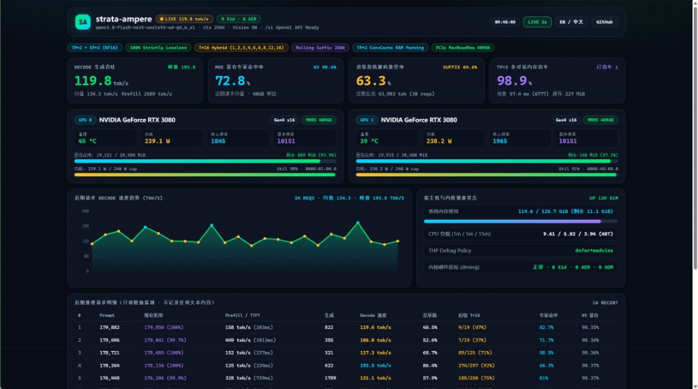

# strata-ampere

<p align="center">
  <b>面向消费级双卡 Ampere（<code>sm_86</code> RTX 3080 20G）与 Turing（<code>sm_75</code> RTX 2080 Ti 22G + NVLink）MoE 大模型推理的 <a href="https://github.com/Niko1221/Strata">Strata</a> 严格无损高吞吐 TP=2 + EP=2 优化分支</b>
</p>

<p align="center">
  <a href="LICENSE"></a>
  <a href="README.en.md"></a>
</p>

<p align="center">
  
  <br>
  <sub><b>内置 8080 端口实时监控仪表盘实拍</b>：双卡 RTX 3080 20GB 连续运行 12H+，180K 超长上下文 100% 缓存复用、峰值 <code>193.5 tok/s</code>、满载 <code>39–45℃</code>、<code>0 Xid · 0 AER · 0 OOM</code></sub>
</p>

`strata-ampere` 基于 [Strata](https://github.com/Niko1221/Strata)（`0.1.60.1`）深度工程优化，现已全面支持两套高性价比魔改双卡平台，以 **100% 严格无损精度** 全面压榨 MoE 大模型的 **Decode 与 Prefill 吞吐**：
- **双魔改 RTX 3080 20 GB（Ampere `sm_86`，40 GB 总显存，无 NVLink / 无 PCIe P2P）**
- **双魔改 RTX 2080 Ti 22 GB（Turing `sm_75`，44 GB 总显存，原生支持物理 NVLink P2P + 硬件 FP16 + `sm_75` INT8 Tensor Core）**

> **口径承诺**：本文所有核心速度均采用**多轮中位数或均速**（绝不拿单次偶发峰值做主指标），所有实验均在 `temperature=0`、零降量化、`STRATA_ROUTE_TAIL_SKIP=0`（不丢弃任何冷门专家）、`BF16` 跨卡 AllReduce 的严格无损条件下实测复现。

---

## 一、核心优化实测速度（中位数 / 均速）

### 1. Decode 生成速度（6 场景严格无损中位数，`REPS=3`）

在默认 `320W` 频率下，基于 `Qwen3.8-Flash-Next-UD-Q4_K_XL`（`MTP-6` 草稿模型，3 轮中位数）：

| 测试场景 | 原始基线（切层流水线） | 早期 TP=2 里程碑 | **`strata-ampere` 优化后中位数（`srv_decode`）** | 相对基线提升 |
|---|---:|---:|---:|---:|
| `ctx512` | `91.6 tok/s` | `103.2 tok/s` | **`155.2 tok/s`**（`154.9`） | `+69.4%` |
| `ctx2048` | `97.2 tok/s` | `118.5 tok/s` | **`168.4 tok/s`**（`168.0`） | `+73.3%` |
| `ctx8192` | `91.9 tok/s` | `115.9 tok/s` | **`169.1 tok/s`**（`168.7`） | `+84.0%` |
| `ctx32768` | `101.1 tok/s` | `111.6 tok/s` | **`171.9 tok/s`**（`171.3`） | `+70.0%` |
| `creative`（中文写作） | `77.4 tok/s` | `93.1 tok/s` | **`131.5 tok/s`**（`131.3`） | `+69.9%` |
| `code`（代码生成） | `89.3 tok/s` | `123.8 tok/s` | **`162.0 tok/s`**（`161.5`） | `+81.4%` |
| **6 场景综合中位均值** | **`91.42 tok/s`** | **`111.02 tok/s`** | **`159.68 tok/s`**（`159.28`） | **`+74.7%`** |

### 2. 草稿模型切换与最新 `DFlash2` + `240W` 无头显存超频实测

同一份二进制无需重编即可切换 `DFlash2 Q4_0`（并已集成 `sm_80+` BF16 Tensor Core 注意力）：

| 场景 / 调优阶段（均为多轮均速） | 优化前 | 优化后（线上实测） | 变化 | 说明 |
|---|---:|---:|---:|---|
| **6 场景均速**（`MTP-6` → `DFlash2 Q4_0`） | `153.16 tok/s` | **`157.45 tok/s`** | `+2.80%` | `code 171.42` / `math 166.87` / `reasoning 197.95` |
| **多步推理 Decode**（开启 DFlash2 BF16 TC） | `148.30 tok/s` | **`154.61 tok/s`** | **`+4.25%`** | 冷启动 + 热缓存 2 轮均值；16K 热缓存同步 `+4.06%` |
| **代码 Decode**（无头超频 + `240W` 帕累托档） | `189.42 tok/s`（默认 320W） | **`207.52 tok/s`**（2 轮均值） | **`+9.6%`** | **功耗直降 80～93 W，满载仅 `41℃`，能效比 `+19.3%`** |
| **代码 Decode**（无头超频 + `320W` 满血档） | `189.42 tok/s`（默认 320W） | **`209.80 tok/s`**（2 轮均值） | **`+10.8%`** | 显存实频 `10,151 MHz`（GDDR6X ECC 临界点内） |
| **代码重构 / Agent JSON / 跨请求**（双级混合草稿 `T=16` + 持久化后缀树） | `185.46 tok/s`（4 场景热态均值） | **`229.98 tok/s`**（3 轮含冷态均值 `206.08`） | **`+24.0%`** | Agent JSON `237.5 → 290.4 tok/s` (`+22.3%`)，Python 重构 `196.0 → 215.9 tok/s` (`+10.1%`)，贪婪 SHA 逐位一致 |
| **深度内核 P0–P4 套件**（`W16 G=1` 全融合 + Prefill 预热 + Reg-MLP AR + `sm_86` INT8 TC） | `186.72 tok/s`（4 任务热态基准） | **`194.55 tok/s`**（`240W`，84K 增量 **`203.5 tok/s`**） | **`+4.2%`** | 84K 冷启动命中率 `70.0% → 79.2%`（`+9.2%`）、Decode `140.1 → 150.7 tok/s`（`+7.6%`）；`cross_req +13.6%`，贪心 SHA 逐位一致 |
| **1 GiB / 2 MiB 静态 HugePages 专家竞技场**（`MAP_HUGE_1GB` 优先 + 2 MiB 内核锁定防驱逐） | `187.28 tok/s`（2 轮均速） / `203.50`（84K 增量） | **`187.76 tok/s`**（2 轮均速） / **`207.90 tok/s`**（84K 增量） | **防驱逐 + 84K `+2.2%`** | 全量 `71.73 GiB` 专家池永久锁入内核 `Hugetlb`（零 Swap / 零 `khugepaged` 整理卡顿）；重启加 `hugepagesz=1G hugepages=72` 自动切 72 页 1 GiB 大页（100% 装入 Zen 2 L2 dTLB） |

### 3. Prefill 提示词处理速度（严格无损，Decode 零退化）

| 上下文长度 / 测试项 | 优化前 | 优化后（线上实测） | 提升幅度 | 备注 |
|---|---:|---:|---:|---|
| **5K 端到端 HTTP TTFT**（`4,908 tok`） | `~2,086 tok/s` | **`2,231.5 tok/s`** | **`+7.0%`** | 异步预锁页 CPU 专家池 + 并行 PLE |
| **10K 端到端 HTTP TTFT**（`9,758 tok`） | `~2,500 tok/s` | **`2,842.8 tok/s`** | **`+13.7%`** | Greedy Hash 100% 一致 |
| **31K 端到端 HTTP TTFT**（`30,648 tok`） | `~3,483 tok/s` | **`3,696 ~ 3,788 tok/s`** | **`+8.7%`** | 单块满载（240W 档 `3,696` / 320W 档 `3,788`） |
| **40K 端到端 HTTP TTFT**（`39,551 tok`） | `3,142.9 tok/s` | **`3,690.9 tok/s`** | **`+17.4%`** | 并行 PLE (`+10.3%`) + `STRATA_PREFILL_EQUAL=1` 均衡分块 (`+8.46%`) |
| **32K 单块引擎内部吞吐**（`32,768 tok`） | `3,823 tok/s`（`8,570 ms`） | **`4,267 tok/s`**（`7,680 ms`） | **`+11.6%`** | PLE 耗时由 `945 ms → 66 ms`（**14.3× 提速**） |

### 4. 双卡 RTX 2080 Ti 22 GB（Turing `sm_75` + 物理 NVLink）实机验证

`strata-ampere` 现已原生适配 **2× 魔改 RTX 2080 Ti 22 GB（共 44 GB 显存，支持 NVLink `NV2` 桥接）**，即便宿主仅配备 6 核工作站 CPU（`Intel Xeon W-2135 6C/12T` + 四通道 DDR4-2666，PCIe Gen3 x16，`Qwen3.8-Flash-Next-UD-Q4_K_XL` 256K 上下文），依然跑出了亮眼的端到端吞吐与 154K 长文零崩溃稳定性：

| 实测维度（2× RTX 2080 Ti 22G + Xeon W-2135 6C） | 优化前（PCIe BF16 / `W8`） | **优化后（NVLink 硬件 FP16 + `sm_75` INT8 TC + P0–P4 `W16`）** | 提升 / 效果 |
|---|---:|---:|---|
| **GPU Verify 窗口基耗时**（`W2 / W3 / W4`） | `55 / 68 / 78 ms` | **`36 / 41 / 46 ms`** | **`-41.0%`**（物理 NVLink `65.8 GB/s` + FP16 Reg-MLP） |
| **短代码 Prompt 端到端**（`67 → 200 tok`） | Prefill `1,124 ms` / `68.7 tok/s` | **Prefill `695 ms` / `72.8 tok/s`** | TTFT **`+61.6%`**，P1 预热命中率 `69.7% → 81.0%` |
| **16K–25K 冷启动长代码库** | `1,361 tok/s` / `74.6 tok/s` | **`1,474.9 tok/s` / `87.7 tok/s`** | Prefill **`+8.4%`**，冷启预热 320 专家仅 `41.7 ms`（命中 **`85.7%`**） |
| **16K–25K 多轮代码重构（`W16` 后缀接龙）** | 增量 `~122 tok/s` / `101 tok/s` | **增量 `150.2 tok/s` / `107.7 ~ 109.2 tok/s`** | 命中率 **`91.3%`**（MTP-6 `107.7` / DFlash2 `109.2 tok/s`） |
| **74K–154K 超长上下文连续生成** | >32K `mtp.cpp` 必现越界崩溃 / `63.7 tok/s` | **110K Prefill `1,570.3 tok/s`，74K–154K Decode `91.0 ~ 103.6 tok/s`** | **彻底根治 >32K 越界崩溃**，Decode **`+55.9%`** |

> **2080 Ti 22G 草稿模型与 CPU 选型实测建议**：
> - 在同套 5 场景严格对照（`T=0`）中，6 核 CPU 平台上 **`MTP-6` 综合均速 `92.68 tok/s`** 领先 **`DFlash2`（`87.32 tok/s`）`+6.1%`**（尤其中文写作 `88.8 vs 70.5 tok/s`、16K 冷启 `80.7 vs 74.2 tok/s`），因 Turing 无 `sm_80+` BF16 注意力张量核且 6 核 CPU 池对过量草稿惩罚更重；但纯代码多轮重构 `DFlash2` 略快（`109.2 vs 107.7 tok/s`）。若宿主升级为 14 核以上多核 CPU（如 HP Z4 G4 升级 `Xeon W-2170B / W-2275` 吃满四通道内存带宽），双卡 2080 Ti 22G 的 Decode 还能再涨 **`+15% ~ +20%`**。

---

## 二、完整硬件与软件环境（公开透明，欢迎复现）

为避免对测试结果的任何质疑，以下为本次所有数据对应的完整宿主机配置：

| 组件 | 实测配置详情 |
|---|---|
| **GPU** | **2× 魔改 RTX 3080 20 GB**（Ampere `sm_86`，每卡 68 SMs / 20 GB GDDR6X，合计 40 GB 显存） |
| **多卡互联** | **无 NVLink，无 PCIe P2P**；双卡直连 CPU PCIe Gen4 x16（`nvidia-smi topo -m` 拓扑为 `NODE`，跨 CPU Host Bridge，当前 `BAR1 = 256 MiB`） |
| **GPU 频率与功耗** | 默认 `320W`（CUDA P2 状态下显存会被降频至 `9,251 MHz`）；线上已启用无头 NVML 帕累托档：**单卡 `240W` + 显存 `10,151 MHz` (`+1800 eff`) + 核心 `2,100 MHz` (`+120`)**，满载温度 **`41℃`** |
| **CPU** | **AMD Ryzen Threadripper 3960X**（24 核 48 线程，8 CCX，Linux `performance` 调频） |
| **系统内存** | **128 GB 四通道 DDR4-3200**（CPU 专家池实测有效吞吐 ~77.8 GB/s） |
| **系统与驱动** | Linux Kernel `6.8.0-138-generic`，NVIDIA Driver **`595.99.02`**，CUDA Toolkit **`13.1`** |
| **测试模型与权重** | **`Qwen3.8-Flash-Next-UD-Q4_K_XL`**（48 层、每层 512 个路由专家、总计 24,576 专家、256K 上下文；40 GB 总显存常驻约 43% 热专家，其余冷专家按需经 PCIe/CPU 混合执行） |
| **关键运行参数** | `--kv int8 --kv-resident 32768 --ple-io ram --prompt-cache 6 --pool-workers 15`、`STRATA_TP2=1`、`STRATA_TP_AR_MODE=bf16`、`STRATA_ROUTE_TAIL_SKIP=0` |

---

## 三、核心优化原理与工作拆解（100% 严格无损精度）

### 严格无损铁律（我们绝不做的事）
所有速度提升**均来自底层架构、算子微核、通信调度与硬件频率/能效调优，绝不以牺牲模型精度换跑分**：
- **零降量化**：保持原始 `UD-Q4_K_XL` 权重精度，不降位宽；
- **零专家丢弃**：强制 `STRATA_ROUTE_TAIL_SKIP=0`，绝不跳过任何低权重路由专家；
- **拒绝有损通信**：跨卡 AllReduce 全程保持 **`BF16`**，明确禁用 `STRATA_TP_AR_MODE=q8`（8-bit 量化 AllReduce）；
- **完整精度与一致性校验**：
  - **19/19 项核心 CUDA/CPU Parity 与微基准回归全过（0 失败）**；
  - **超长上下文大海捞针测试**：~150K 字符 / ~87K token（深度 0.5）**3/3 精确命中**；
  - **严格 A/B 淘汰纪律**：所有实测导致精度偏差或负优化的方案均当场回滚，包括 `STRATA_NV_CHUNK=16`（31K `-8.0%` / Decode `-7.2%`）、`STRATA_DEQUANT_SIDE + PLE_COMPACT`（Decode `-7.8%`）、`gr_write_norm_rs` 单 Block 复用（寄存器溢出反慢 `+283 ms`）、上游 `iq_kernels.cu` Q4_K/Q5_K 融合核（覆盖原有 `sm_86` `s27` 核导致 Decode `-7.0%`）以及显存 `+2200 MHz`（触发 GDDR6X 静默 ECC 重传掉速 `-7.4%`）。

---

### 1. Decode 优化原理：打破非 P2P 双卡通信墙与 Ampere 微核瓶颈
- **非 P2P 真 `TP=2 + EP=2` 全链路重构**（`src/kernels/cuda/tp_comm.cu`）：
  - 全 48 层注意力 / GDN / QSA / 共享 MLP / LM Head 50/50 Tensor Parallel + 24,576 路由专家 50/50 互不重叠 Expert Parallel，双卡同时干活。
  - 针对消费级 3080 屏蔽 PCIe P2P 的限制，手写**锁页主机内存（Mapped Pinned Host Memory）环形缓冲 + 原子 `step` 零休眠自旋同步（Zero-Sleep Barrier）**，移除 `ld.acquire.sys` 轮询中的 `__nanosleep(40)`，彻底绕过 CPU 调度与同步延迟，96 次 AllReduce 实测节省 `~80–91 us`。
- **Ampere `sm_86`（68 SMs）手调 CUDA 微核**：
  - 定制 `Q8_0` / `Q4_0` 专用微核（`q8_sm86_fast.cuh`、`q4_sm86.cuh`），重调 `RPB/TPR` 分块并支持 `native_mmvq_pair`。
  - 针对 RTX 3080 的 68 SMs 重新实测标定 `kIlRows_86` 调度表（替代原 RTX A4000 参数，如 `Q4_K 6144×2560 T=2` 从 `24.8 us → 16.0 us`）。
  - 36 层 GDN Split 补齐树解码支持（`STRATA_GDN_SPLIT=1`）；`S27` 常驻专家核加入 `__ldg` 只读缓存加载。
- **DFlash2 `sm_80+` BF16 Tensor Core 注意力**（`src/kernels/cuda/dflash2.cu`）：
  - 移植基于 PTX `mma.sync.aligned.m16n8k16` 的 BF16 Tensor Core 注意力，保留精确 FP32 在线 Softmax，多步推理 Decode 再涨 `+4.25%`、16K 长上下文热缓存再涨 `+4.06%`。
- **代码/Agent 零算力持久化后缀树 + DFlash2 双级混合草稿（16-Token 长窗口）**（`include/strata/spec/rolling_suffix.hpp`、`src/core/dflash2.cpp`、`src/core/verify.cpp`、`src/program/generate.cpp`）：
  - 解除 `Dflash2Drafter::draft_launch` 对单轮提交行数 `<= 8` 的硬上限（`n_new > 8` 时自动分块写入 KV 环与 ring log 后直接触发块草稿），并将 `Verifier::prepare(T)` 升级为 TP=2 双卡协同校验，彻底打通双卡 + DFlash2 下的 **`--lookup-max-t 16 --lookup-sizes 8,12,16 --lookup-chain 6`** 与 `STRATA_DF2_LOOKUP_SKIP=6`（强匹配时跳过 DFlash2 神经网络草稿直接走零算力后缀查表）。
  - 新增跨请求持久化滚动后缀树 `RollingSuffixSource`（`STRATA_SUFFIX_CACHE=1`，默认 256K Token 有界自动压缩，~10 MiB 内存），同时服务主后缀查表与 `--lookup-chain` 接龙，并自动过滤多模态 `<|image_pad|>` 占位符防污染。实测 4 场景热态均速 **`185.46 → 229.98 tok/s（+24.0%）`**，Agent JSON 改写达 **`290.40 tok/s（+22.3%）`**、代码重构达 **`215.85 tok/s（+10.1%）`**，全新未见 Prompt 零退化、贪婪解码 SHA 100% 逐位一致。
- **TP=2 双卡多对话内存泊车（`ConversationCache`）**（`src/program/generate.cpp`）：
  - 解除原版 `STRATA_TP2=1` 下硬编码禁用多对话缓存（`o.conversation_cache_mib = 0` 与 `park_current` 跳过 `tp1`）的限制，将 GPU 1（`tp1->ss` 与 `c.tp1_part` 检查点）完整接入 `ConversationCache` 增量泊车与回滚恢复链路。
  - 在真实双标签页 Coding Agent（Tab A 12.6K ⇄ Tab B 6.8K）切换实测中，切回 Tab A 的缓存复用率从 **`0% → 99.7%`（12,648 tok，仅 `55 ms` 内存恢复）**，TTFT 从 **`4,869.8 ms → 499.3 ms`（9.75× 提速）**，且完整支持泊车对话内的编辑/重算检查点回滚（`57.4 ms` 精确恢复）。
- **深度微核与长上下文架构升级（P0–P4，100% 严格无损）**：
  - **P0（`T=16` 单组全融合 + 5 桶长上下文成本模型）**：启用 `-DSTRATA_WINDOW_MAX_T=16`，并解除 `verify.cpp` 与 `native_router.cu` 中 `can_mega_router` / `STRATA_LFUSE` / `hits_in_combine` 的 `n <= 8` 硬上限，使 `T=12/16` 混合窗口跑在单组 `G=1`（AllReduce 栅栏由 192 次砍半至 96 次）；同时将 `DraftPolicy` 扩展至 5 个上下文分桶（`<6K / <24K / <64K / <128K / >=128K`）。
  - **P1（Prefill 引导热专家抢跑预热 + 双卡显存配平）**：复用 `Prefill::on_routes` 零开销统计 Prompt 真实路由热力图，Prefill 结束瞬间仅用 `~13.5 ms` 提前把 Top-K 缺失热专家异步拉进双卡显存（`STRATA_PREFILL_PREWARM=1`），配合 GPU 0 预留由 `1050 → 680 MiB` 释放 `+368 MiB` 显存多常驻专家，84K 冷启动命中率直涨 `70.0% → 79.2%`、Decode `140.1 → 150.7 tok/s`。
  - **P2（`tp_comm.cu` 寄存器缓存去重读 + `K` 路并发 PCIe MLP 流水线）**：新增模板核 `tp_allreduce_bf16_reg_kernel<K>`（`K=1,2,3,5`），跨栅栏将 `local_buf` 保存在寄存器中彻底消除二次显存重读，并连续并发发射全部 `K` 路 `load_cv_u4` PCIe 读隐藏往返延迟。
  - **P3（按批内命中次数阈值动态分流 A/B 验证）**：在 `expert_source.cpp` 实现可选 `STRATA_PCIE_HIT_MIN=N`，但在本机四通道 DDR4-3200（`77.8 GB/s`）+ 非 P2P 双卡上实测 `--pcie-frac 0.30` 反降 `-4.6%`（因关闭片上 `can_mega_router` 且 PCIe 搬冷专家与 AllReduce 争抢主桥带宽），按严格无回退原则默认关闭（`--pcie-frac 0`），保留为慢速双通道内存平台可选开关。
  - **P4（Ampere `sm_86` + Turing `sm_75` INT8 Tensor Core）**：在 `q8_sm86_fast.cuh` 与 `native_mmvq.cu` 中为 `T = 8..16` 的 `Q8_0 × Q8_1` 稠密投影与 LM Head 引入 PTX 张量核（`STRATA_Q8_TC=1`）——Ampere `sm_80+` 走 `mma.sync.aligned.m16n8k32`，Turing `sm_75`（RTX 2080 Ti）自动走 4 条 `mma.sync.aligned.m8n8k16.row.col.s32.s8.s8.s32` 拼出完全按位等价的 `16×8×32` `int32` 点积（2080 Ti 独立校验 `0/4096` 误差），单次加载 16×32 权重瓦片共享给最多 16 列。3080 240W 4 任务热态均速刷新至 **`194.55 tok/s`**、84K 增量突破 **`203.50 tok/s`**。
  - **Turing `sm_75` + NVLink 专项增强与 >32K 稳定性修复**：
    - `tp_comm.hpp` / `tp_comm.cu` 新增 **NVLink P2P 直连显存通路（`STRATA_TP_AR_P2P=1` + 双向 BAR1 硬件写入自检防坏主桥 `#2666`）**、`tp_allreduce_fp16_reg_kernel<K>`（硬件 FP16 寄存器缓存 + `K` 路并发）与 Prefill 硬件 FP16 打包/解包核（`STRATA_TP_AR_MODE=fp16` / `STRATA_TP_AR_DECODE=fp16`），实测双 2080 Ti NVLink 双向聚合 **`65.8 GB/s`**；
    - 修复 `src/core/mtp.cpp` 在上下文 **`> 32,768` tokens** 时 `window_ids` 覆写共享 `ident_` 数组导致 `iq_embed_rows` 越界访问崩溃（`illegal memory access`）的底层 Bug，并补充 CUDA 12.x / 13.x `cudaGraphAddNode` 兼容宏。
- **底层内存与跨层预取架构升级（1 GiB / 2 MiB 静态 HugePages + 可选 L3 预取）**：
  - **1 GiB / 2 MiB 静态 HugePages 专家竞技场**（`src/core/pinned.cu`、`src/core/expert_source.cpp`）：升级 `PinnedArena::reserve()` 优先尝试 `MAP_HUGETLB | MAP_HUGE_1GB`（`72` 页覆盖 `71.73 GiB`，512× 压缩页表并 100% 装入 Zen 2 2048 项 L2 dTLB），自动回退 `MAP_HUGE_2MB`（`36,727` 页）并直接读取 `sysfs` 1G/2M 大页空闲池（消除 20s 误判等待）。本机在线实测 `36,727 × 2 MiB` 静态 `Hugetlb` + `cudaHostRegister PORTABLE ok`，240W 2 轮均速刷新至 **`187.76 tok/s`**、84K 增量 Decode 达 **`207.90 tok/s`**，且 71.73 GiB 专家池永久锁定零 Swap 抖动（持久化于 `/etc/sysctl.d/99-strata-hugepages.conf`；若需升至 1 GiB 静态大页，移除该 sysctl 并在 GRUB 加 `hugepagesz=1G hugepages=72` 重启即可自动接管）。
  - **跨层 `L → L+1` 可中断 CPU L3 缓存预取（可选 `STRATA_L3_PREWARM=1|2`）**（`src/kernels/cpu/pool.cpp`、`src/core/verify.cpp`、`src/program/generate.cpp`）：实现路由前瞻（`=1`）与零路由器权重时序高频冷专家（`=2`）两种可 `<0.5 us` 即时中止的 L3 预取，但在 2×3080 40 GB（9,750 专家已常驻显存，剩余冷专家长尾精确率仅 `36–38%`）实测会与 GPU PCIe AllReduce 争抢 DDR4 控制器导致负优化，按严格无回退铁律默认关闭（`=0`），保留为小显存单卡场景可选实验开关。
- **CPU 专家池 CCX 绑核对齐**：
  - `--pool-workers 15` 跨 Threadripper 8 个 CCX 绑核（`15 worker + 1 host` = 16 活跃线程），吃满四通道 DDR4-3200 带宽且避免跨 CCX 争抢。

### 2. Prefill 优化原理：用 Profiler 揪出隐形软件堵点
- **14.3× 并行内存 PLE 查表**（`src/kernels/ngram.cpp`）：
  - 通过 `STRATA_PREFILL_TIMING=1` 发现原版 `--ple-io ram` 在单线程中对 524,288 行狂刷数十万次无意义的 `madvise()` 系统调用，在 GPU 0 吃掉 `945 ms` 并连累 GPU 1 在 AllReduce 栅栏空等 `+518 ms`。
  - 改为最多 8 线程并行 `PleTable::gather_batch` 并在内存已锁页/预热时跳过 `madvise()`，PLE 耗时从 **`945 ms → 66 ms`（占比仅 `0.9%`）**，32K 单块吞吐直冲 **`4,267 tok/s`**（已逼近 `96× BF16 PCIe Gen4 AllReduce` 16.1 GB 物理带宽墙）。
- **异步预锁页 CPU 专家池协作**（`src/prefill/prefill.cpp`、`src/kernels/cpu/pool.cpp`）：
  - 预锁页 `cpu_x / cpu_rows / cpu_ones` + 独立异步 `cpu_x_stream` D2H 拷贝流 + `ExpertPool::run_range` 多线程并行量化，并调优 `STRATA_PREFILL_CPU_SHARE_NT=32, MAX=6144`，4K～5K Prefill 提速 `+8.9%`。
- **多块均衡切分（`STRATA_PREFILL_EQUAL=1`）**：
  - 解决 40K 长提示词被切成 `32K + 7K` 导致小尾块重复扫 PCIe 冷专家掉速的问题，改为 `20K + 20K` 均衡双块，40K 端到端 Prefill 再涨 **`+8.46%`**（直接追平 31K 单块速度）。

### 3. Linux 底层无头调优：NVML 显存超频、240W 能效与 PCIe `MaxReadReq=4096B`
- **解除 CUDA P2 显存降频 + 240W 帕累托能效**：发现 NVIDIA 驱动默认 CUDA P2 状态会将 RTX 3080 GDDR6X 降频 `-250 MHz`（`9,501 → 9,251 MHz`）；通过开源脚本 [scripts/ampere-oc-power.py](scripts/ampere-oc-power.py) 锁定 Micron GDDR6X ECC 峰顶（`+1800` 为峰顶，`+2200` 触发静默 ECC 重传掉速），配合单卡 **`240W`** 功耗墙保留 **98.9% 极限 Decode 速度（`207.52 tok/s`）**，Prefill 功耗直降 **93 W**、满载温度仅 **`41℃`**、能效比提升 **`+19.3%`**。
- **PCIe `MaxReadReq 512B → 4096B` + `THP defrag=defer+madvise`**：绝大多数主板默认将消费级 GPU 的 PCIe `MaxReadRequestSize` 限制在 `512 bytes`，导致每次冷专家 DMA 读取被切碎成 8 倍事务包。热调至 **`4096 bytes`**（`setpci CAP_EXP+0x08.w`）并将内核透明大页整理设为异步 `defer+madvise` 后，**零额外功耗下 `decode_code` 均速再涨 `+5.07%`、`decode_reason` 再涨 `+3.38%`**，所有 Linux 多卡用户均可一键复现！

---

## 四、编译、快速启动与无头超频工具

### 1. 编译（支持 Ampere `sm_86` 与 Turing `sm_75`）
依赖 CUDA Toolkit 12.8 / 13.1、CMake、Ninja（或 Make）与 C++20 编译器：

```bash
# 双 RTX 3080 20G（Ampere sm_86）
export PATH=/usr/local/cuda-13.1/bin:$PATH
cmake -B build86 -G Ninja \
  -DCMAKE_BUILD_TYPE=Release \
  -DSTRATA_ENABLE_CUDA=ON \
  -DSTRATA_WINDOW_MAX_T=16 \
  -DCMAKE_CUDA_ARCHITECTURES=86
cmake --build build86 --target strata -j $(nproc)

# 双 RTX 2080 Ti 22G（Turing sm_75，原生启用 m8n8k16 INT8 Tensor Core + NVLink 硬件 FP16）
export PATH=/usr/local/cuda-12.8/bin:$PATH
cmake -B build75 \
  -DCMAKE_BUILD_TYPE=Release \
  -DSTRATA_ENABLE_CUDA=ON \
  -DSTRATA_WINDOW_MAX_T=16 \
  -DCMAKE_CUDA_ARCHITECTURES=75
cmake --build build75 --target strata -j $(nproc)
```

### 2. 草稿模型选型与配置启动
同一份二进制无需重编即可切换草稿模型：
- **双 RTX 3080 20G — 偏代码 / 数学 / 逻辑推理（推荐）**：使用 `DFlash2 Q4_0` 模板 [examples/strata-2x3080-20g-dflash2.example.json](examples/strata-2x3080-20g-dflash2.example.json)。
- **双 RTX 3080 20G — 偏中文创意写作 / 全能均衡**：使用 `MTP-6` 模板 [examples/strata-2x3080-20g.example.json](examples/strata-2x3080-20g.example.json)（高随机性创作快 `~12.5 tok/s`）。
- **双 RTX 2080 Ti 22G（`sm_75` + NVLink）**：直接使用 [examples/strata-2x2080ti-22g.example.json](examples/strata-2x2080ti-22g.example.json)（已预配 `STRATA_TP_AR_P2P=1`、`STRATA_TP_AR_MODE=fp16`、`STRATA_TP_AR_DECODE=fp16`、`STRATA_Q8_TC=1`、`STRATA_PREFILL_PREWARM=1` 与 `W16` 混合后缀缓存）。

复制模板并替换模型路径与 `CHANGE_ME_API_KEY` 后启动：
```bash
python3 serve/server.py --config /path/to/strata-2x3080-20g-dflash2.example.json
```

### 3. 一键无头显存超频、PCIe `4096B` 与 240W 帕累托能效（无需重启引擎）
```bash
# 一键应用 240W + GDDR6X 10,151 MHz + PCIe MaxReadReq=4096B + THP defer+madvise
sudo python3 scripts/ampere-oc-power.py --mem-offset 1800 --gpc-offset 120 --power-limit 240 --pcie-mrrs 4096 --thp-defrag defer+madvise

# 一键恢复出厂默认频率与功耗墙
sudo python3 scripts/ampere-oc-power.py --reset
```

### 4. 一键采集领域专属 MoE 专家热力图（`scripts/profile-experts.py`）
针对半显存常驻架构，内置 `coding` / `writing` / `research` / `balanced` 四套语料（亦支持 `--prompts-file` 传入你自己的日志），结合 RRF 贝叶斯先验融合（`--prior-blend 0.45`）将高频领域专家精准晋升进显存（实测 Coding 冷启动显存命中率 `82.13% → 84.00%`，Python/C++ 未见任务冷启动最高 `+13.3%`）：
```bash
sudo python3 scripts/profile-experts.py \
  --config /path/to/strata-config.json \
  --unit strata@iq3_s \
  --domain coding \
  --out /path/to/expert-profile-coding.bin \
  --activate
```

### 5. 8080 端口内置实时监控仪表盘（零依赖，开箱即用）
启动 `serve/server.py` 后，直接用浏览器访问原服务端口（如 `http://<server-ip>:8080/`）即可打开上图所示的实时遥测面板（支持 **中文 / English** 一键切换），**无需额外端口或第三方监控栈**：
- **OpenAI API 100% 兼容不变**：`/v1/*` 全部推理接口原样保留，Cline / Cursor / Claude Code / OpenWebUI 无缝直连；
- **全链路核心指标一屏可见**：Decode 实时吞吐与趋势折线、MoE 显存专家命中率、DFlash2 / `T=16` 混合草稿接受率、TP=2 多对话 RAM 泊车恢复延迟、双卡温度/功耗/频率/显存与 PCIe `MRRS 4096B` 状态；
- **硬件健康自动巡检与零隐私暴露**：后端 [serve/ampere_metrics.py](serve/ampere_metrics.py) 提供只读纯数值接口 `GET /api/ampere/metrics`，定时巡检 `dmesg`（`0 Xid / 0 AER / 0 OOM`），不记录也不输出任何 API Key 或对话原文。

---

## 五、上游致谢与开源协议

`strata-ampere` 派生自 [Niko1221/Strata](https://github.com/Niko1221/Strata)，遵循原仓库的 **MIT License**（见 [LICENSE](LICENSE)）。基础引擎架构、Pack 格式、KV Streaming 与验证框架均归功于 Niko1221 及 Strata 社区贡献者。
